# Lumin

**A WYSIWYG Markdown editor for people who write — math, diagrams, code, and spell check.**

[](LICENSE) [](https://github.com/yangbaibai-ops/Lumin/releases) [](https://www.electronjs.org/) [](https://vuejs.org/)

**English** | [简体中文](README.zh-CN.md)

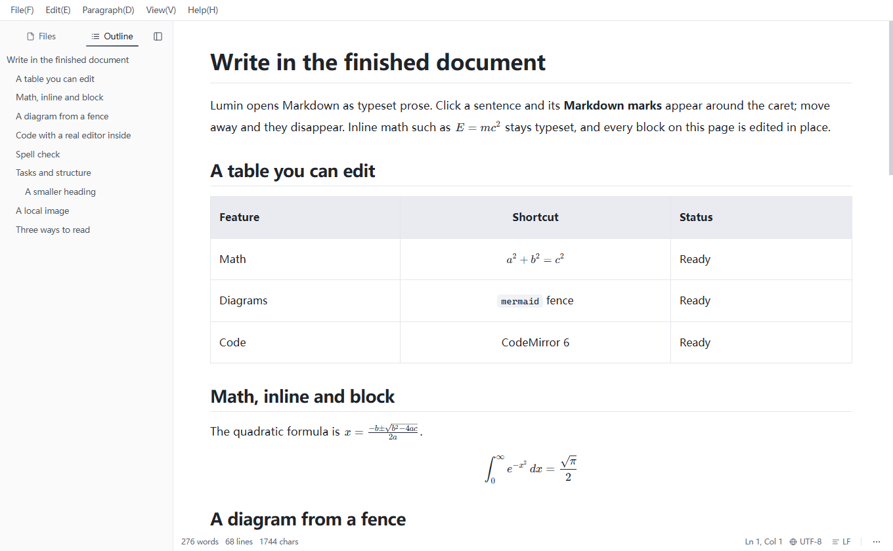

Lumin opens `.md` files as typeset prose. Click the sentence you want to change and its Markdown marks appear around the caret; move the caret away and they disappear. Tables, formulas, diagrams, and code blocks are edited in place, so writing never turns into a source-and-preview round trip.

## Features

### WYSIWYG editing


Headings, bold, italic, strikethrough, inline code, blockquotes, lists, task lists, tables, images, links, and horizontal rules all render inline. Syntax markers stay hidden until the caret enters a construct; a setting can keep inline markers hidden at all times. The document model is still Markdown, so what you save is what the file contains.

### Three viewing modes

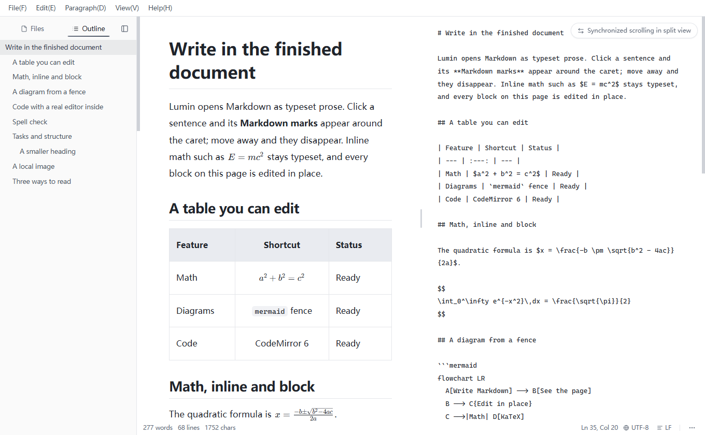

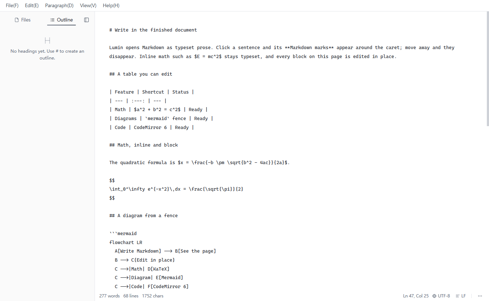

The toolbar's segmented control and `Ctrl+/` switch between rendered, split, and source. Split view can synchronise the two panes, and the default mode can also be chosen in Settings → Editor.

### Math


Inline `$…$` and block `$$…$$` formulas are rendered with KaTeX. KaTeX and its fonts ship with the app, so formulas render without a CDN or network connection. Click a formula to edit its Markdown source with a live preview.

### Mermaid diagrams

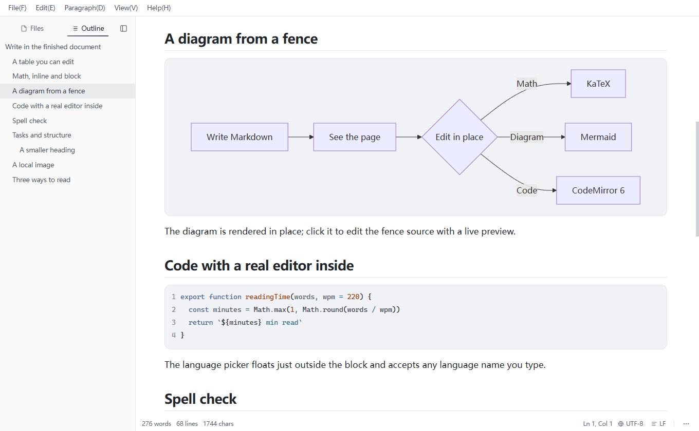

A fenced block tagged `mermaid` renders in place. The diagram runtime is loaded lazily; click a diagram to edit the fence source with a live preview underneath. If the source does not parse, the source is kept and the error is reported instead of replacing it.

### Code blocks

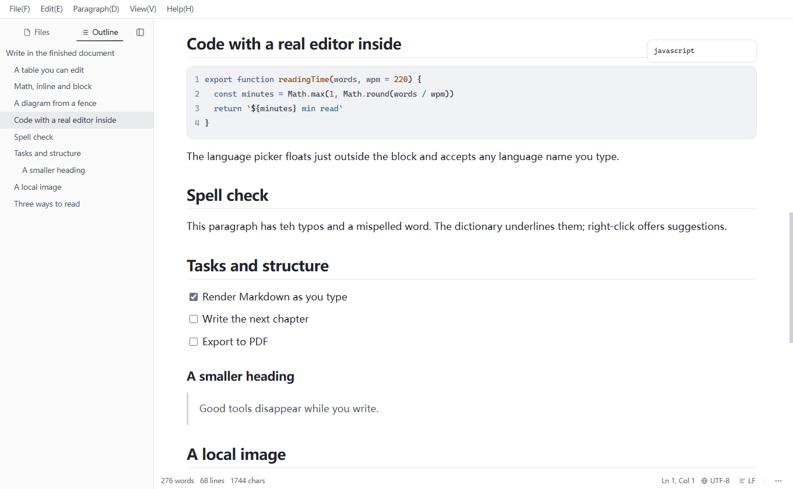

Code blocks embed CodeMirror 6 with syntax highlighting, line numbers, bracket completion, autocompletion, and soft wrapping. The language picker floats outside the block, accepts any language name, and auto-detects the language when the fence has none. Code text is not rewritten by a Markdown round trip.

### Spell check

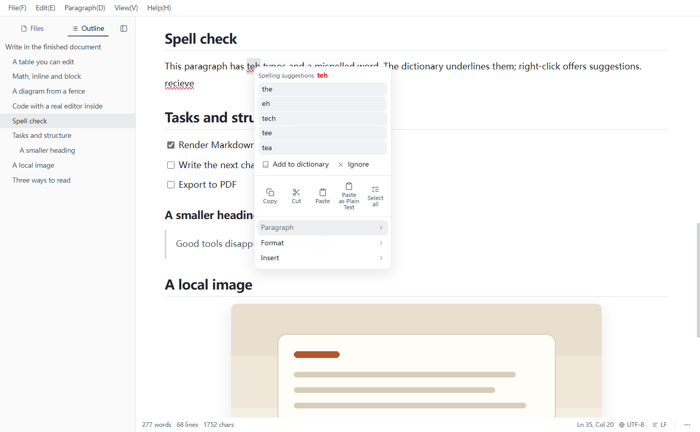

English uses the dictionary supplied by Electron and the operating system; right-clicking a flagged word shows suggestions. Chinese uses heuristic rules instead of a dictionary: repeated characters and words, half-width punctuation inside Chinese text, unbalanced bracket pairs, a short list of common confusions, and optional CJK–Latin spacing hints. Code blocks, math source, and Mermaid source are excluded from both.

### Tables


Add or remove rows and columns, and set a column's alignment to left, center, or right. The table remains ordinary Markdown in the file.

### Images

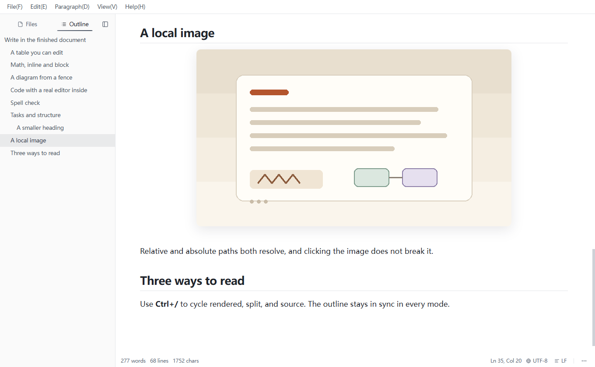

Relative and absolute image paths both resolve, and local images are served through the app's own file protocol. Clicking an image keeps it loadable while exposing its Markdown source, and images can be resized in place.

### Task lists and headings

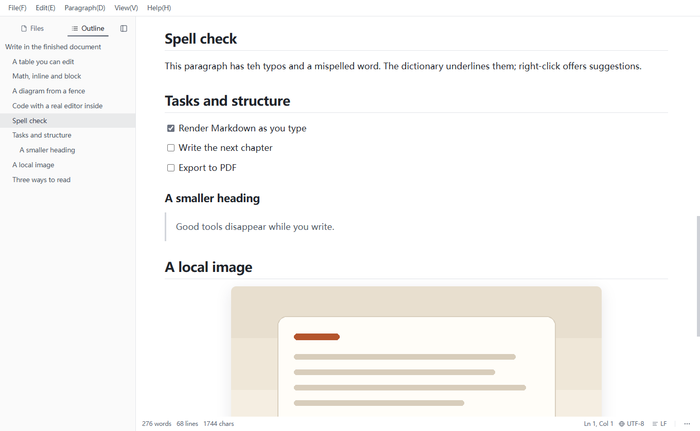

Task checkboxes and heading levels are edited in place and stay part of the Markdown document. The outline is built from that heading structure rather than from a separate table of contents.

### Outline and the right dock


The outline lives in the left sidebar by default. An optional 40-pixel dock on the right can hold the outline instead, so the file tree and the outline are visible at the same time. Both the dock and the outline side are switches in Settings → General.

### Themes and interface languages

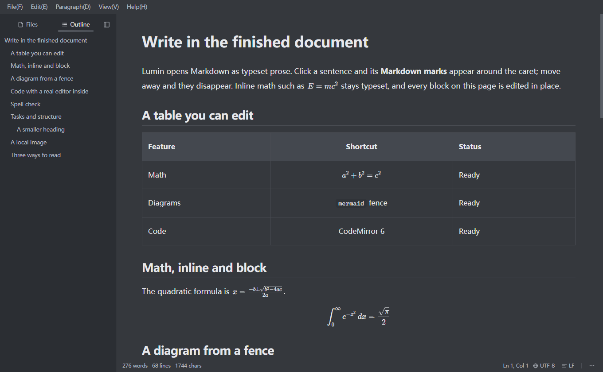

Light, dark, and sepia themes are available, along with English, Simplified Chinese, and Russian interface languages. Theme and language changes apply immediately.

### Stability and recovery

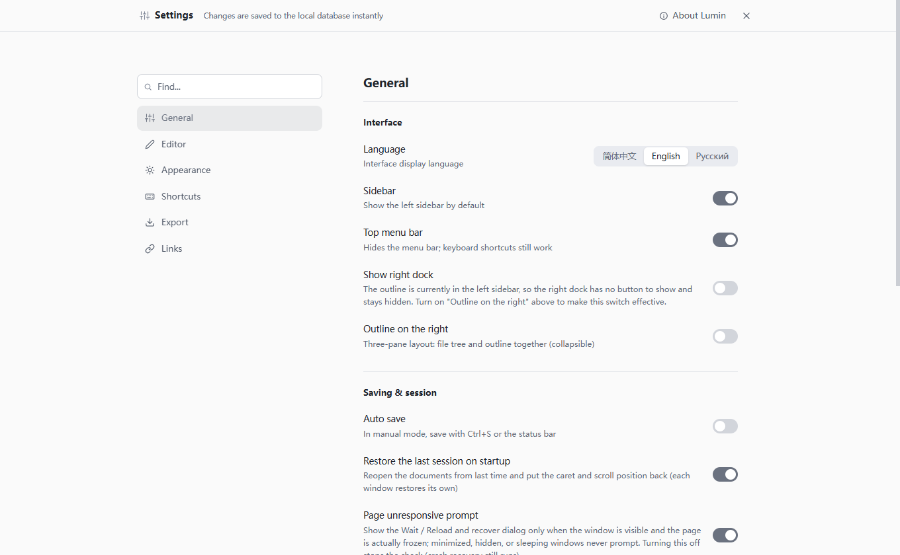

A paste-size guard warns before very large clipboard content can lock up the editor. A heartbeat watchdog notices an unresponsive window and offers to wait or reload, flushing the draft first; a crashed renderer is reloaded automatically with throttling. Drafts survive an unexpected exit, closing with unsaved changes uses a native confirmation dialog, and saves are atomic (temporary file, flush, rename). Temporary files left by interrupted writes are swept on startup.

### Keyboard shortcuts

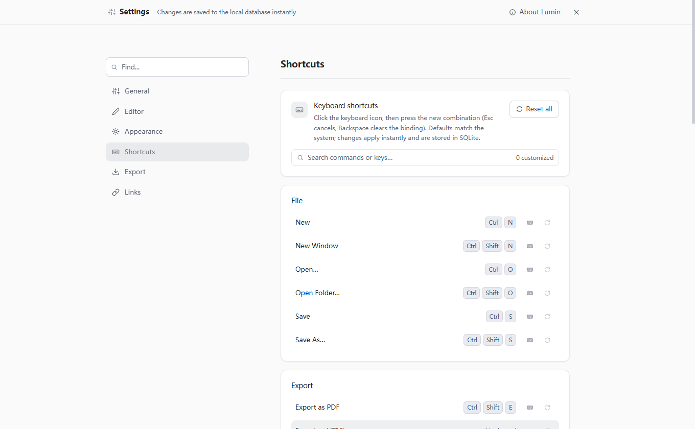

Every application binding can be reassigned or unbound in Settings → Shortcuts. These are the factory defaults; `Ctrl` is the Windows modifier. Editor-level undo, redo, and formatting keys are handled by the editor keymap.

| Action | Default shortcut |
| --- | --- |
| New / New window | `Ctrl+N` / `Ctrl+Shift+N` |
| Open file / Open folder | `Ctrl+O` / `Ctrl+Shift+O` |
| Save / Save as | `Ctrl+S` / `Ctrl+Shift+S` |
| Print / Export PDF | `Ctrl+P` / `Ctrl+Shift+E` |
| Find / Replace | `Ctrl+F` / `Ctrl+H` |
| Paste as plain text | `Ctrl+Shift+V` |
| Bold / Italic | `Ctrl+B` / `Ctrl+I` |
| Strikethrough / Inline code | `Ctrl+Shift+X` / `Ctrl+E` |
| Insert link | `Ctrl+Alt+K` |
| Insert table / Horizontal rule | `Ctrl+Alt+T` / `Ctrl+Alt+H` |
| Insert image / Code block | `Ctrl+Alt+Shift+I` / `Ctrl+Alt+Shift+C` |
| Insert block math / Mermaid | `Ctrl+Alt+M` / `Ctrl+Alt+G` |
| Insert paragraph above / below | `Ctrl+Alt+↑` / `Ctrl+Alt+↓` |
| Toggle sidebar / legacy binding | `Ctrl+Shift+L` / `Ctrl+Shift+B` |
| Focus mode | `Ctrl+Shift+F` |
| Command palette | `Ctrl+Shift+P` |
| Settings / Shortcut settings | `Ctrl+,` / `Ctrl+K` |
| Cycle editor mode (rendered / split / source) | `Ctrl+/` |
| Next / previous window | `Ctrl+Tab` / `Ctrl+Shift+Tab` |
| Close window | `Ctrl+W` |

The registry that defines these defaults is `src/renderer/src/composables/useKeymap.ts`. Editor-level bindings are declared in `src/renderer/src/lib/editor/keymap.ts` and `src/renderer/src/lib/editor/inlineMarks.ts`.

### Export and the command palette

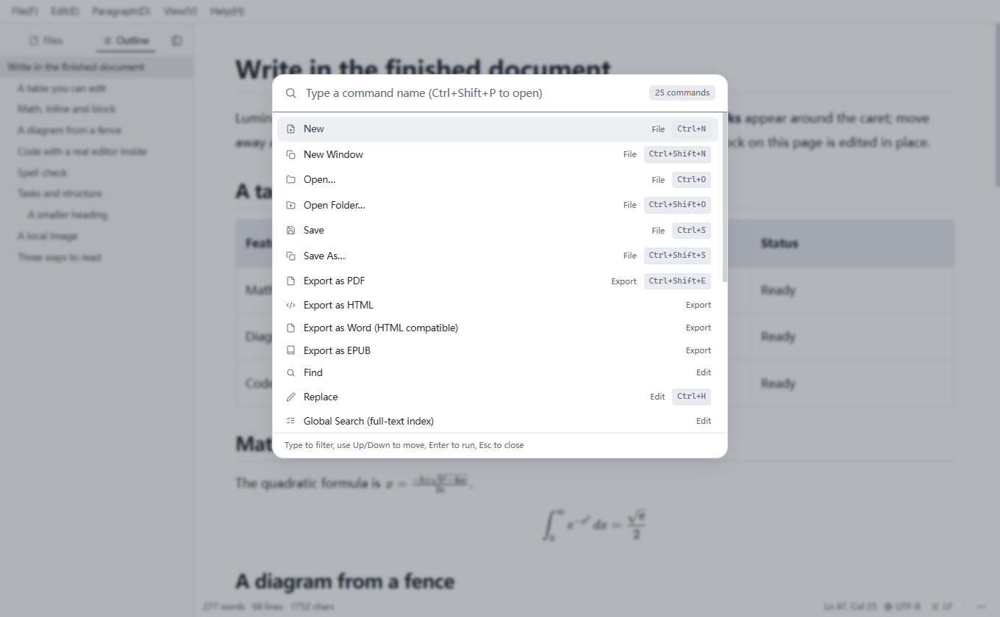

Export to PDF, HTML, Word (HTML-compatible `.html` that Word can open and edit — not OOXML `.docx`), and EPUB. PDF uses Chromium's print pipeline and gets page numbers and a header; EPUB splits at top-level headings and embeds local images. The command palette (`Ctrl+Shift+P`) runs any command by name, including the export commands shown here.

## Install

### Download the installer

1. Open the [Releases page](https://github.com/yangbaibai-ops/Lumin/releases) and download the latest `Lumin-1.0.0-setup.exe`.
2. Run the installer and choose an install location. It creates Start-menu and desktop shortcuts.
3. The installer is **not code-signed** yet, so Windows SmartScreen may show “Windows protected your PC”. Choose **More info → Run anyway** to continue.
4. The first launch after installing can take a few seconds while Windows Defender scans the new files and the file cache is cold. Lumin shows its paper-coloured boot screen immediately; later launches are faster. Reinstalling writes new files, so the first launch after a reinstall can be slow again.

### Requirements

- Windows 10 or Windows 11, 64-bit.
- To build from source: Node.js 22 (`>= 22 < 25`) and a Windows desktop session.

### Build from source

```powershell
npm install
npm run build:win
```

The installer and update metadata are written to `dist/` (`Lumin-1.0.0-setup.exe`, `latest.yml`, and the `.blockmap` files). For development with hot reload, run `npm run dev`.

## Development

```powershell
npm install
npm run dev            # development with hot reload
npm run typecheck      # type-check the main process and the renderer
npm run test:unit      # unit tests (node --test)
npm run ci             # typecheck + lint + unit tests + notices/docs checks + production build
npm run build          # production build into out/
npm run test:suites    # default CDP acceptance matrix (run npm run build first)
```

`npm run test:suites` launches the built app from `out/` in isolated profiles and drives it over the DevTools protocol. It needs a real Windows desktop session; each suite gets a fresh user-data directory and its own debugging port. `npm run test:suites:all` runs the full matrix.

## Architecture

Lumin is an Electron application with a context-isolated bridge between the main process and a Vue renderer.

| Path | Contents |
| --- | --- |
| `src/main/` | Electron main process, IPC handlers, window and session management, file I/O, export and print, update checks, freeze and crash guards |
| `src/preload/` | The context-isolated `window.luminAPI` bridge |
| `src/renderer/src/` | Vue app, Tiptap / ProseMirror document model, CodeMirror 6 code blocks, KaTeX and Mermaid rendering |
| `src/shared/` | Settings schema, i18n bundles, and Markdown, export, encoding, and spell-check rules used by both processes |
| `tools/` | CDP acceptance suites and release / documentation scripts |
| `tests/` | Unit tests (`node --test`) |
| `docs/` | Manual, design notes, and screenshots |

## Contributing

Contributions are welcome. Read [CONTRIBUTING.md](CONTRIBUTING.md) for the workflow, commit message format, and test expectations before opening a pull request. By taking part you agree to the [Code of Conduct](CODE_OF_CONDUCT.md). Please report security issues privately as described in [SECURITY.md](SECURITY.md).

## License

Lumin is released under the [MIT License](LICENSE). Third-party components and their licenses are listed in [THIRD-PARTY-NOTICES.md](THIRD-PARTY-NOTICES.md). Contribution guidelines are in [CONTRIBUTING.md](CONTRIBUTING.md).

Copyright (c) 2026 Lumin.

## Acknowledgements

Built with [Electron](https://www.electronjs.org/), [Vue](https://vuejs.org/), [Tiptap](https://tiptap.dev/), [ProseMirror](https://prosemirror.net/), [CodeMirror](https://codemirror.net/), [KaTeX](https://katex.org/), and [Mermaid](https://mermaid.js.org/).
