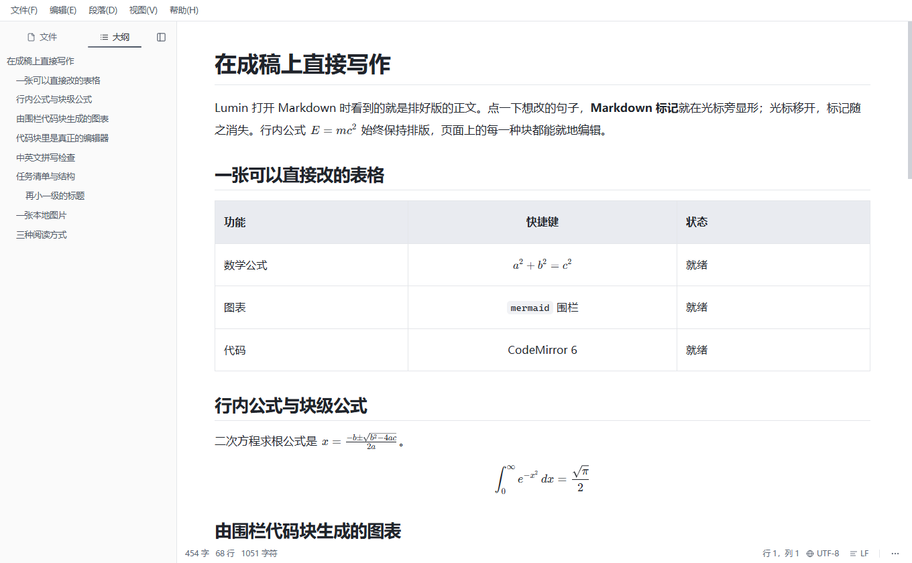
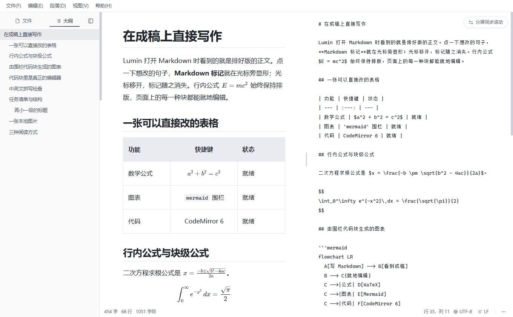
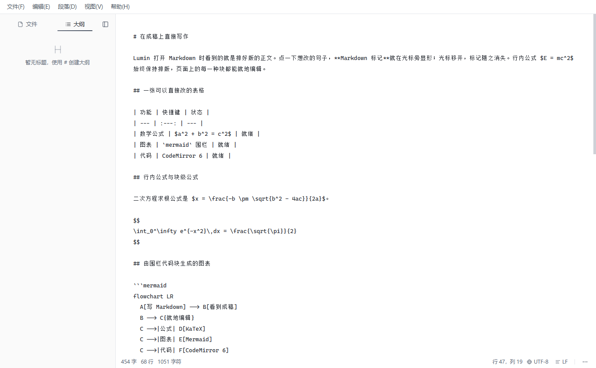
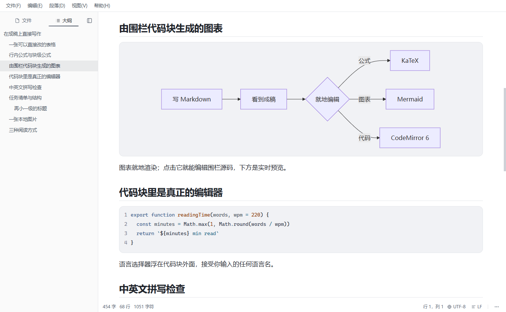
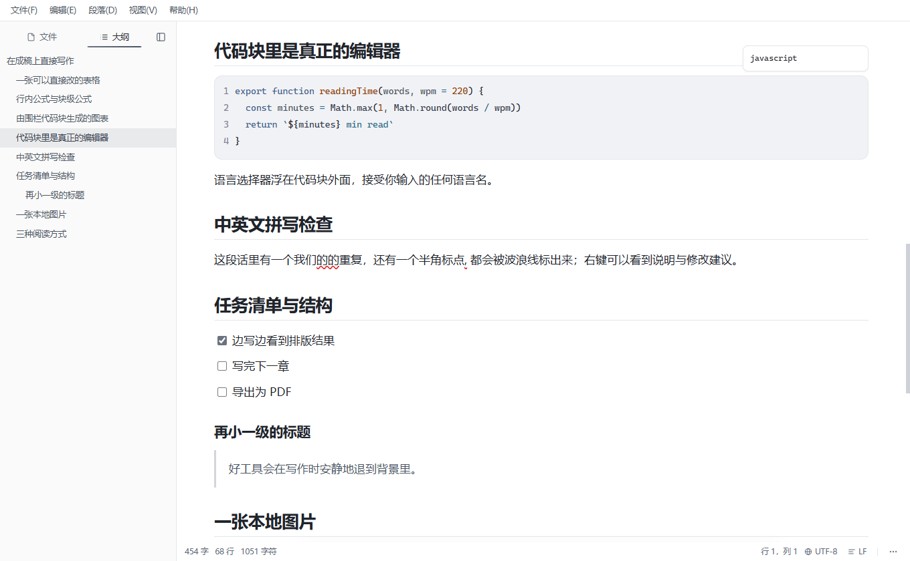
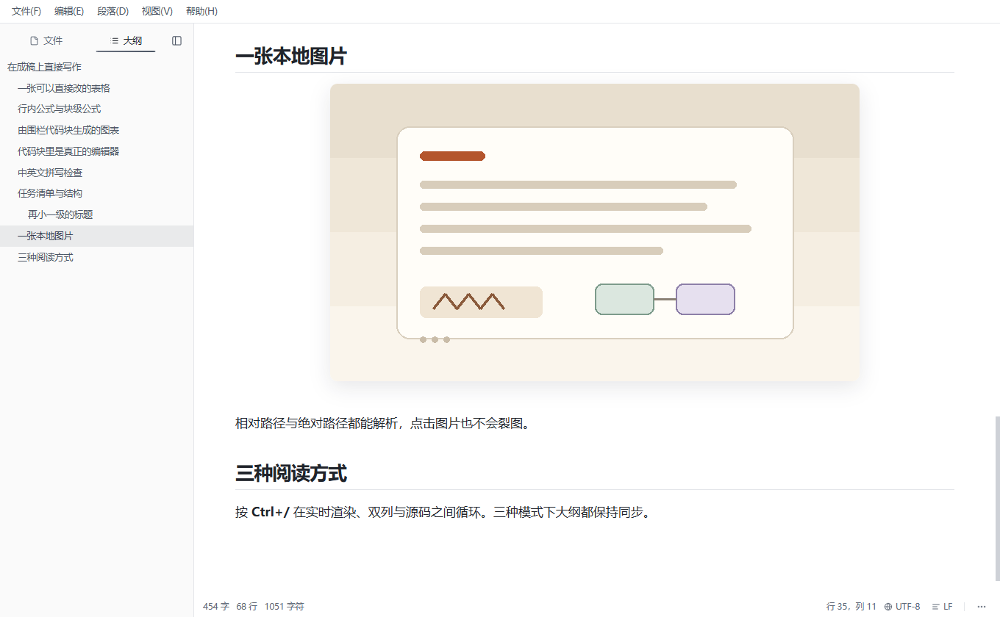
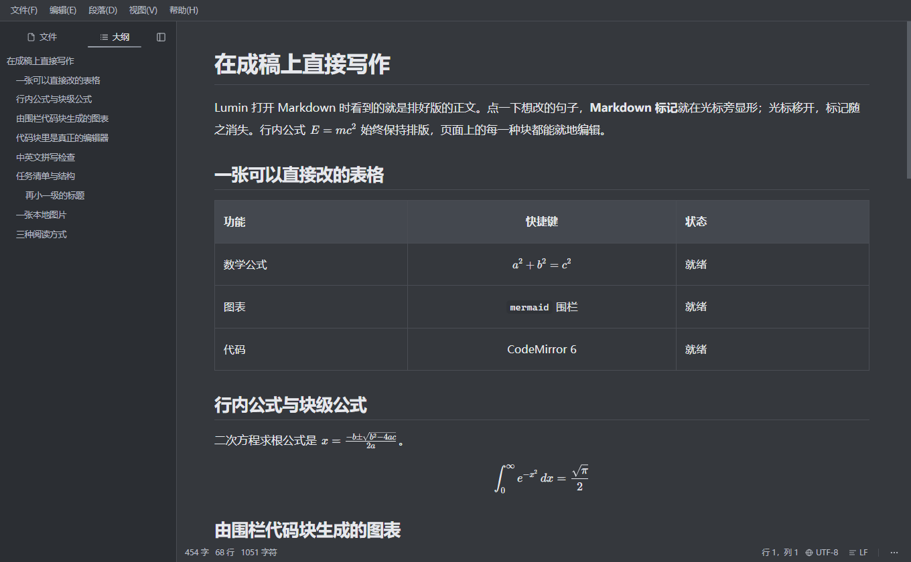
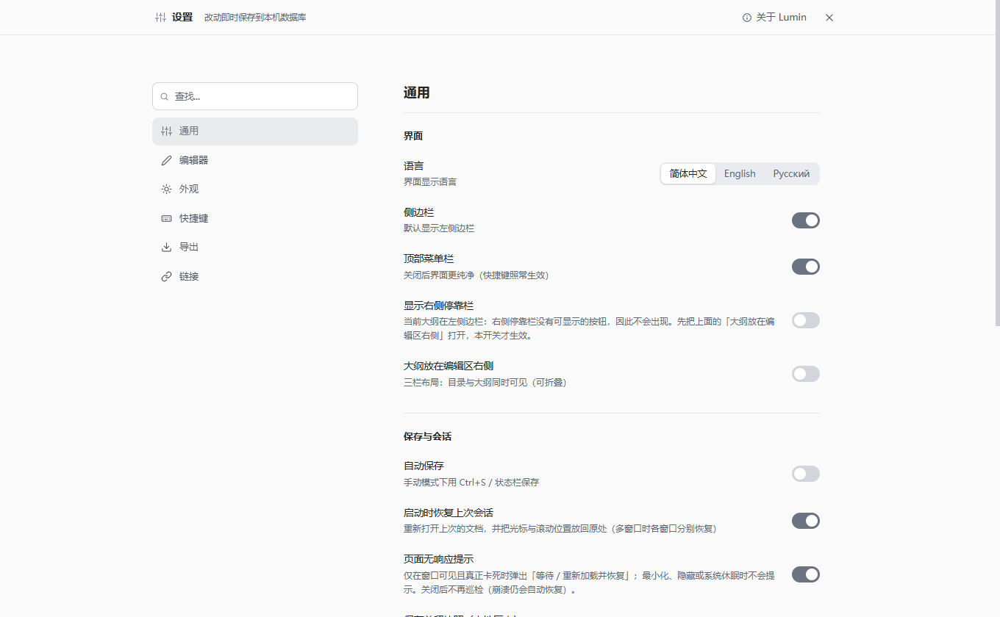
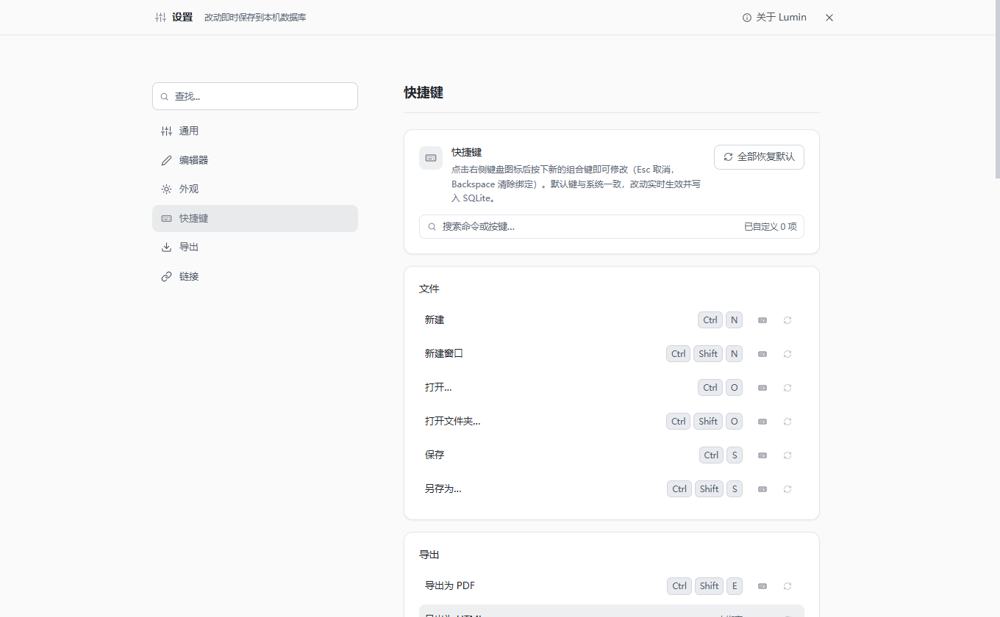
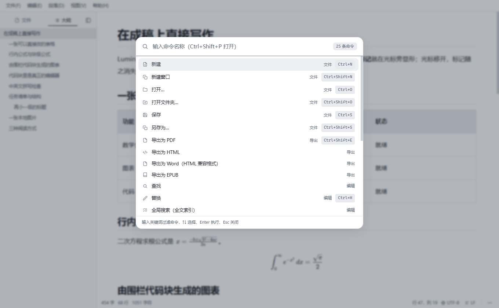

# Lumin

**面向写作者的所见即所得 Markdown 编辑器 —— 公式、图表、代码与拼写检查。**

[](LICENSE) [](https://github.com/yangbaibai-ops/Lumin/releases) [](https://www.electronjs.org/) [](https://vuejs.org/)

[English](README.md) | **简体中文**



Lumin 打开 `.md` 文件时，看到的就是排好版的正文。想改哪一句就点哪一句，Markdown 标记只在光标所在的那一段出现；光标移开，标记随之消失。表格、公式、图表与代码块全部就地编辑，写作时不必在源码和预览之间来回切换。

## 功能

### 所见即所得


标题、加粗、斜体、删除线、行内代码、引用、列表、任务列表、表格、图片、链接与分割线都按排版后的样子直接编辑。语法标记默认只在光标进入对应结构时显形；设置里也可以让行内标记始终隐藏。文档模型仍然是 Markdown，保存下来的就是文件里真实存在的内容。

### 三种观看模式





工具栏的分段控件与 `Ctrl+/` 可以在实时渲染、双列、源码之间切换。双列可以把两侧滚动同步起来，默认编辑模式也可以在「设置 → 编辑器」里选择。

### 数学公式


行内 `$…$` 与块级 `$$…$$` 公式由 KaTeX 渲染。KaTeX 与字体随应用一起发布，不请求 CDN，断网也能显示。点击公式可以编辑它的 Markdown 源码，并逐键实时预览。

### Mermaid 图表



语言标注为 `mermaid` 的围栏代码块会就地渲染成图表。图表运行时按需加载；点击图表可以编辑它真实的围栏源码，下方是实时预览。解析失败时保留源码并报告错误，不会把原文替换掉。

### 代码块



代码块内嵌 CodeMirror 6：语法高亮、行号、括号补全、自动补全与自动换行。语言选择器浮在代码块外面，接受任意语言名；围栏没有写语言时会自动识别。代码内容不经过 Markdown 往返改写。

### 拼写检查


英文使用 Electron 与操作系统提供的词典，右键标出的单词可以看到替换建议。中文使用启发式规则而不是词典：重复字词、中文句里的半角标点、成对符号不配对、少量高置信易错词，以及可选的中英之间缺空格提示。代码块、公式源码与 Mermaid 源码都不参与检查。

### 表格


可以增删行列，并把整列设为左对齐、居中或右对齐。表格在文件里仍然是普通 Markdown。

### 图片



相对路径与绝对路径的图片都能解析，本地图片通过应用自己的文件协议加载。点击图片会显形它的 Markdown 源码，但不会让图片失效；图片也可以就地缩放。

### 任务清单与标题层级


任务复选框与标题层级都就地编辑，并保留在 Markdown 文档里。大纲由文档的标题结构生成，不依赖另一份目录。

### 大纲与右侧停靠栏


大纲默认在左侧边栏。右侧有一条可选的 40 像素停靠栏，可以把大纲搬到编辑区右边，让文件树与大纲同时可见。停靠栏是否显示、大纲放在左边还是右边，都在「设置 → 通用」里切换。

### 主题与界面语言



提供浅色、深色、羊皮纸三种主题，以及简体中文、English、Русский 三种界面语言。主题与语言切换立即生效。

### 稳定性与恢复



超大粘贴有规模护栏，在编辑器被拖死之前先给出提示。心跳看门狗能发现窗口无响应，并让你选择继续等待或重载，重载前先落盘草稿；渲染进程崩溃后会自动重载（有节流保护）。异常退出后草稿仍在，带未保存修改关闭窗口会使用原生确认对话框，保存采用原子写（临时文件、刷新、重命名）。中断写入留下的临时文件会在启动时清理。

### 快捷键



所有应用级键位都可以在「设置 → 快捷键」里改绑或解绑。下表是出厂默认值；`Ctrl` 即 Windows 上的修饰键。编辑器内的撤销、重做与格式键位由编辑器键位表处理。

| 操作 | 默认快捷键 |
| --- | --- |
| 新建 / 新建窗口 | `Ctrl+N` / `Ctrl+Shift+N` |
| 打开文件 / 打开文件夹 | `Ctrl+O` / `Ctrl+Shift+O` |
| 保存 / 另存为 | `Ctrl+S` / `Ctrl+Shift+S` |
| 打印 / 导出 PDF | `Ctrl+P` / `Ctrl+Shift+E` |
| 查找 / 替换 | `Ctrl+F` / `Ctrl+H` |
| 粘贴为纯文本 | `Ctrl+Shift+V` |
| 加粗 / 斜体 | `Ctrl+B` / `Ctrl+I` |
| 删除线 / 行内代码 | `Ctrl+Shift+X` / `Ctrl+E` |
| 插入链接 | `Ctrl+Alt+K` |
| 插入表格 / 分割线 | `Ctrl+Alt+T` / `Ctrl+Alt+H` |
| 插入图片 / 代码块 | `Ctrl+Alt+Shift+I` / `Ctrl+Alt+Shift+C` |
| 插入块级公式 / Mermaid | `Ctrl+Alt+M` / `Ctrl+Alt+G` |
| 上方 / 下方插入段落 | `Ctrl+Alt+↑` / `Ctrl+Alt+↓` |
| 切换侧栏 / 旧版键位 | `Ctrl+Shift+L` / `Ctrl+Shift+B` |
| 专注模式 | `Ctrl+Shift+F` |
| 命令面板 | `Ctrl+Shift+P` |
| 设置 / 快捷键设置 | `Ctrl+,` / `Ctrl+K` |
| 循环编辑模式（实时渲染 / 双列 / 源码） | `Ctrl+/` |
| 下一个 / 上一个窗口 | `Ctrl+Tab` / `Ctrl+Shift+Tab` |
| 关闭窗口 | `Ctrl+W` |

应用级默认键位定义在 `src/renderer/src/composables/useKeymap.ts`；编辑器内的键位定义在 `src/renderer/src/lib/editor/keymap.ts` 与 `src/renderer/src/lib/editor/inlineMarks.ts`。

### 导出与命令面板



可以导出 PDF、HTML、Word（HTML 兼容格式的 `.html`，Word 能直接打开编辑，但不是 OOXML `.docx`）与 EPUB。PDF 走 Chromium 的打印管线，带页码与页眉；EPUB 按顶层标题拆章并内嵌本地图片。命令面板（`Ctrl+Shift+P`）可以按名称执行任意命令，上面的导出命令也在其中。

## 安装

### 下载安装包

1. 打开 [Releases 页面](https://github.com/yangbaibai-ops/Lumin/releases)，下载最新的 `Lumin-1.0.0-setup.exe`。
2. 运行安装包并选择安装位置；安装器会创建开始菜单与桌面快捷方式。
3. 安装包**尚未做代码签名**，首次运行时 Windows SmartScreen 可能提示「Windows 已保护你的电脑」。点「更多信息 → 仍要运行」即可继续。
4. 安装后的第一次启动可能要几秒：Windows Defender 正在扫描新写入的文件，系统文件缓存也是冷的。Lumin 会立刻显示纸色启动画面，之后的启动会快得多；重装会重新写入文件，所以重装后的第一次也可能再次变慢。

### 系统要求

- Windows 10 / 11（64 位）。
- 从源码构建还需要 Node.js 22（`>= 22 < 25`）与 Windows 桌面会话。

### 从源码构建

```powershell
npm install
npm run build:win
```

安装包与更新元数据会写到 `dist/`（`Lumin-1.0.0-setup.exe`、`latest.yml` 与对应的 `.blockmap`）。开发模式（热重载）直接运行 `npm run dev`。

## 镜像

以 GitHub 为主仓库，Gitee 与 GitCode 为只读镜像；Issue 请优先提交到 GitHub。

- GitHub（主仓库）：<https://github.com/yangbaibai-ops/Lumin>
- Gitee：<https://gitee.com/yangbai-bai/Lumin>
- GitCode：<https://gitcode.com/yangbaibai-ops/Lumin>

## 开发

```powershell
npm install
npm run dev            # 开发模式（热重载）
npm run typecheck      # 类型检查（主进程 + 渲染层）
npm run test:unit      # 单元测试（node --test）
npm run ci             # 类型检查 + ESLint + 单测 + 声明/文档检查 + 生产构建
npm run build          # 生产构建，产物在 out/
npm run test:suites    # 默认 CDP 验收矩阵（先跑 npm run build）
```

`npm run test:suites` 会从 `out/` 启动构建产物，用独立的 profile 起实例，并通过 DevTools 协议驱动真实窗口。它需要真实的 Windows 桌面会话；每个套件使用全新的 user-data 目录与独立的调试端口。`npm run test:suites:all` 跑完整矩阵。

## 架构

Lumin 是 Electron 应用：主进程与 Vue 渲染层之间只通过 context-isolated 的预加载桥通信。

| 目录 | 内容 |
| --- | --- |
| `src/main/` | Electron 主进程、IPC 处理器、窗口与会话管理、文件读写、导出与打印、更新检查、防卡死与崩溃守卫 |
| `src/preload/` | context-isolated 的 `window.luminAPI` 桥 |
| `src/renderer/src/` | Vue 应用、Tiptap / ProseMirror 文档模型、CodeMirror 6 代码块、KaTeX 与 Mermaid 渲染 |
| `src/shared/` | 设置 schema、国际化文案，以及两侧共用的 Markdown、导出、编码与拼写检查规则 |
| `tools/` | CDP 验收套件与发布 / 文档脚本 |
| `tests/` | 单元测试（`node --test`） |
| `docs/` | 手册、设计说明与截图 |

## 贡献

欢迎参与贡献。提交 PR 之前请先阅读 [CONTRIBUTING.md](CONTRIBUTING.md)，其中说明了开发流程、提交信息格式与测试要求。参与本项目即表示同意遵守 [CODE_OF_CONDUCT.md](CODE_OF_CONDUCT.md)。安全问题请按 [SECURITY.md](SECURITY.md) 的渠道私下报告。

## 许可

Lumin 以 [MIT 许可](LICENSE)发布。第三方组件及其许可见 [THIRD-PARTY-NOTICES.md](THIRD-PARTY-NOTICES.md)，贡献指引见 [CONTRIBUTING.md](CONTRIBUTING.md)。

版权所有 © 2026 Lumin。

## 致谢

使用 [Electron](https://www.electronjs.org/)、[Vue](https://vuejs.org/)、[Tiptap](https://tiptap.dev/)、[ProseMirror](https://prosemirror.net/)、[CodeMirror](https://codemirror.net/)、[KaTeX](https://katex.org/) 与 [Mermaid](https://mermaid.js.org/) 构建。
