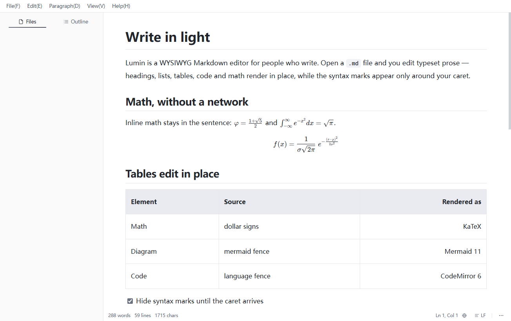
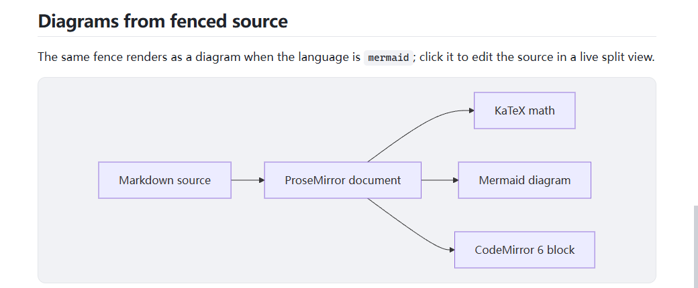
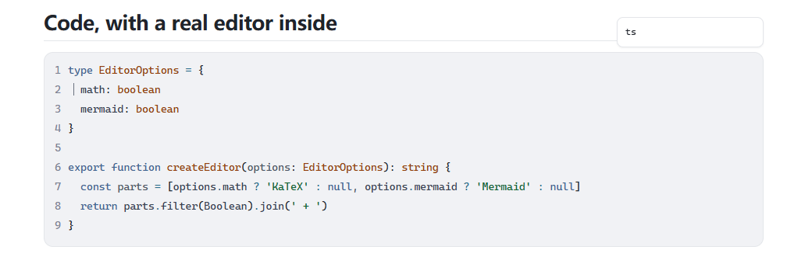
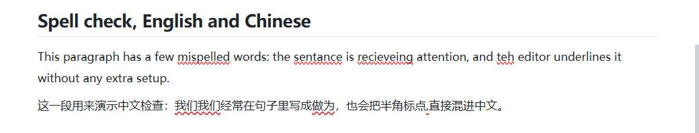
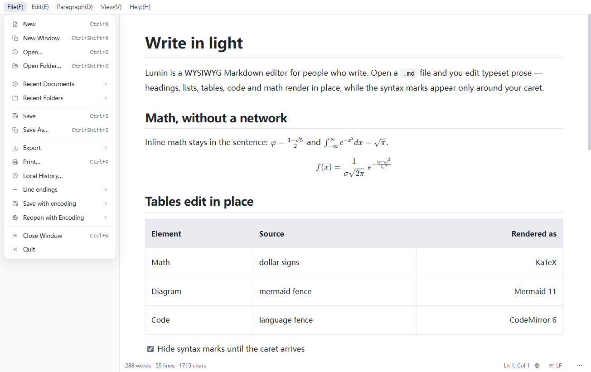
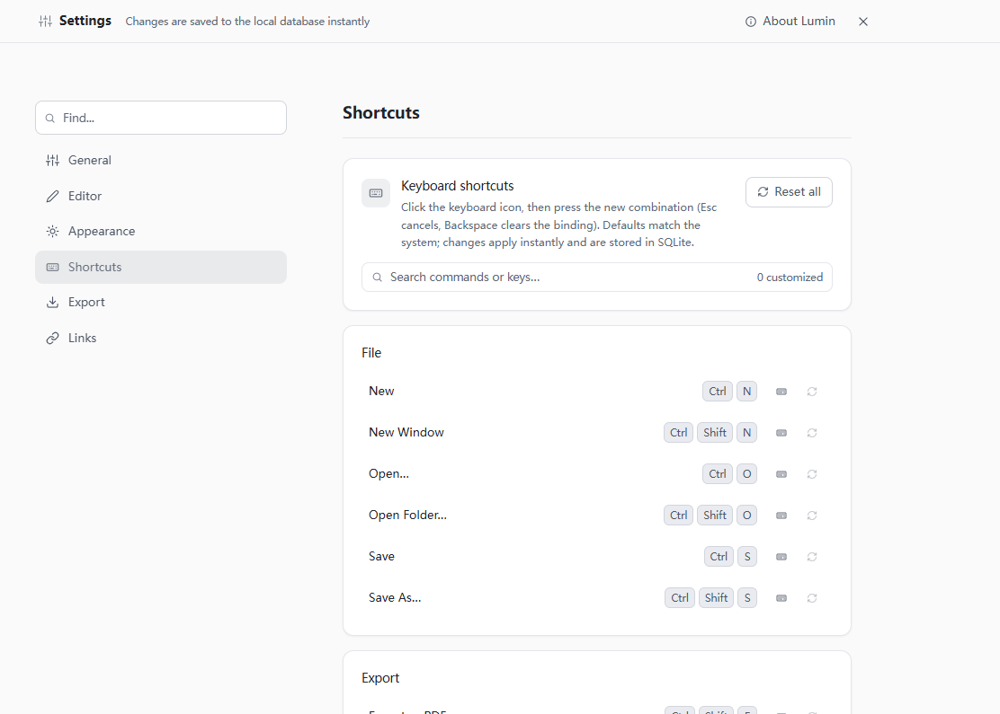

# Lumin

**面向写作者的所见即所得 Markdown 编辑器 —— 数学公式、Mermaid、代码、拼写检查。**

<p>
  <a href="LICENSE"></a>
  
  
  
</p>

[English](README.md) | **简体中文**



Lumin 打开 `.md` 文件时，看到的就是排好版的正文。想改哪一句就点哪一句，Markdown 标记只在你
光标所在的那一段出现；光标移开，标记随之消失。表格、公式、图表与代码块全部就地编辑，不需要
切到源码模式，也不用另开预览页。

## 截图

|                             Mermaid 图表                             |                                      代码块                                       |
| :------------------------------------------------------------------: | :-------------------------------------------------------------------------------: |
|  |  |

|                                  拼写检查                                  |                                应用菜单                                 |
| :------------------------------------------------------------------------: | :---------------------------------------------------------------------: |
|  |  |



## 功能

### 编辑

- 标题、加粗、斜体、删除线、行内代码、引用、有序 / 无序 / 任务列表、表格、图片、链接、
  分割线，全部按排版后的样子直接编辑。
- 语法标记默认只在光标进入对应结构时显形，页面读起来就是成稿的样子；设置里可以让行内标记
  始终隐藏。
- 多光标、拖动选字、撤销 / 重做、查找替换。
- 正文支持中日韩输入法；状态栏显示字数、行数、行列位置、编码与行尾（CRLF / LF 可在状态栏切换）。

### 数学公式

- 行内 `$…$` 与块级 `$$…$$`，由 KaTeX 渲染。
- KaTeX 与字体随安装包发布，不请求 CDN，断网也能渲染。
- 点击公式即可编辑源码，逐键实时预览；源码仍然是标准 Markdown。

### Mermaid 图表

- 语言标注为 `mermaid` 的围栏代码块会就地渲染成图表。
- 图表按需懒加载；点击图表会打开它真实的围栏源码，下方是实时预览。
- 解析失败时保留源码并给出错误提示。

### 代码块

- 块内嵌 CodeMirror 6：语法高亮、行号、括号补全、自动补全与自动换行。
- 语言选择器浮在代码块之外，可自由输入语言名；围栏没有写语言时会自动识别。
- 代码内容不经过 Markdown 往返改写。

### 拼写检查

- 英文使用 Electron / 操作系统提供的词典；在标出的单词上右键可以看到替换建议。
- 中文使用启发式规则，而不是词典：重复字词、中文句里的半角标点、成对符号不配对、少量高置信
  易错词（例如 `做为` → `作为`），以及可选的中英之间缺空格提示。
- 代码块、公式源码与 Mermaid 源码不参与拼写检查。

### 表格、图片与结构

- 增删行列，并设置整列对齐（左 / 中 / 右）。
- 插入与粘贴图片，就地缩放。
- 大纲面板、分屏视图，以及文件夹工作区的文件树。

### 稳定性与恢复

- 超大粘贴有规模护栏，在编辑器被拖死之前先给出提示。
- 心跳看门狗能发现窗口无响应，并让你选择继续等待或重载（重载前先落盘草稿）；渲染进程崩溃后会
  自动重载（有节流保护）。
- 异常退出后草稿仍在，下次启动时可以恢复。
- 有未保存修改时关闭窗口，使用原生确认对话框。
- 全局撤销：焦点离开正文后 `Ctrl+Z` 仍然有效。

### 界面

- 浅色、深色、羊皮纸三种主题；简体中文、English、Русский 三种界面语言。
- 每一条键位都可以在「设置 → 快捷键」里改绑或解绑。
- 命令面板可按名称执行命令。
- 导出 PDF、HTML、Word、EPUB。

## 安装

### 下载安装包

1. 打开 [Releases](https://github.com/yangbaibai-ops/Lumin/releases) 页面，下载最新的
   `Lumin-1.0.0-setup.exe`。
2. 运行安装包并选择安装位置；安装器会创建开始菜单与桌面快捷方式。
3. 安装包**尚未做代码签名**，首次运行时 Windows SmartScreen 可能提示「Windows 已保护你的电脑」。
   点「更多信息 → 仍要运行」即可继续。

### 系统要求

- Windows 10 / 11（64 位）。
- 从源码构建还需要 Node.js 22（`>= 22 < 25`）与 Windows 桌面会话。

### 从源码构建

```powershell
npm install
npm run build:win
```

安装包与更新元数据会写到 `dist/`（`Lumin-1.0.0-setup.exe`、`latest.yml` 与对应的 `.blockmap`）。
开发模式（热重载）：

```powershell
npm run dev
```

## 快捷键

下表是出厂默认键位。`Mod` 在 Windows 上就是 `Ctrl`。应用级命令定义在
[`src/renderer/src/composables/useKeymap.ts`](src/renderer/src/composables/useKeymap.ts)；编辑器内的
格式键位定义在
[`src/renderer/src/lib/editor/inlineMarks.ts`](src/renderer/src/lib/editor/inlineMarks.ts) 与
[`src/renderer/src/lib/editor/keymap.ts`](src/renderer/src/lib/editor/keymap.ts)。所有键位都能在
「设置 → 快捷键」里改绑或解绑。

| 操作                               | 快捷键                                  |
| ---------------------------------- | --------------------------------------- |
| 新建 / 新建窗口                    | `Ctrl+N` / `Ctrl+Shift+N`               |
| 打开文件 / 打开文件夹              | `Ctrl+O` / `Ctrl+Shift+O`               |
| 保存 / 另存为                      | `Ctrl+S` / `Ctrl+Shift+S`               |
| 打印 / 导出 PDF                    | `Ctrl+P` / `Ctrl+Shift+E`               |
| 查找 / 替换                        | `Ctrl+F` / `Ctrl+H`                     |
| 粘贴为纯文本                       | `Ctrl+Shift+V`                          |
| 加粗 / 斜体                        | `Ctrl+B` / `Ctrl+I`                     |
| 删除线 / 行内代码                  | `Ctrl+Shift+X` / `Ctrl+E`               |
| 插入链接                           | `Ctrl+Alt+K`                            |
| 插入表格 / 分割线                  | `Ctrl+Alt+T` / `Ctrl+Alt+H`             |
| 插入图片 / 代码块                  | `Ctrl+Alt+Shift+I` / `Ctrl+Alt+Shift+C` |
| 插入块级公式 / Mermaid             | `Ctrl+Alt+M` / `Ctrl+Alt+G`             |
| 上方 / 下方插入段落                | `Ctrl+Alt+↑` / `Ctrl+Alt+↓`             |
| 切换侧栏 / 专注模式                | `Ctrl+Shift+B` / `Ctrl+Shift+F`         |
| 命令面板                           | `Ctrl+Shift+P`                          |
| 打开设置 / 快捷键设置              | `Ctrl+,` / `Ctrl+K`                     |
| 循环编辑模式（实时 / 分屏 / 源码） | `Ctrl+/`                                |
| 下一个 / 上一个窗口                | `Ctrl+Tab` / `Ctrl+Shift+Tab`           |
| 撤销 / 重做                        | `Ctrl+Z` / `Ctrl+Y`                     |

## 开发

```powershell
npm install
npm run dev            # 开发模式（热重载）
npm run typecheck      # 类型检查（主进程 + 渲染层）
npm run test:unit      # 单元测试（node --test）
npm run ci             # 类型检查 + ESLint + 单测 + 声明/文档检查 + 生产构建
npm run build          # 生产构建，产物在 out/
npm run test:suites    # 默认 CDP 验收矩阵（先跑 npm run build）
```

`npm run test:suites` 会从 `out/` 启动构建产物，用独立 profile 起实例，并通过 DevTools 协议驱动
真实窗口。它需要真实的 Windows 桌面会话；每个套件使用全新的 user-data 目录与独立的调试端口。
`npm run test:suites:all` 跑完整矩阵。

## 架构

Lumin 是 Electron 应用：主进程与 Vue 渲染层之间只通过 context-isolated 的预加载桥通信。

- **主进程**（`src/main`）：窗口与会话管理、文件读写、原生菜单、导出与打印、更新检查，以及
  防卡死 / 崩溃守卫。
- **预加载**（`src/preload`）：通往主进程的唯一桥，以 `window.luminAPI` 暴露给页面。
- **渲染层**（`src/renderer`）：Vue 3 界面。Tiptap / ProseMirror 是文档模型，代码块由
  CodeMirror 6 编辑，公式交给 KaTeX，图表交给 Mermaid。
- **共享层**（`src/shared`）：设置 schema、国际化文案，以及两侧共用的 Markdown、导出、编码与
  拼写检查规则。

| 目录                | 内容                                                |
| ------------------- | --------------------------------------------------- |
| `src/main/`         | Electron 主进程、IPC 处理器与服务                   |
| `src/preload/`      | context-isolated 的 `window.luminAPI` 桥            |
| `src/renderer/src/` | Vue 应用、Tiptap 编辑器、CodeMirror、KaTeX、Mermaid |
| `src/shared/`       | 设置、国际化与两侧共用的格式规则                    |
| `tools/`            | CDP 验收套件与发布 / 文档脚本                       |
| `tests/`            | 单元测试（`node --test`）                           |
| `docs/`             | 手册、设计说明与截图                                |

## 贡献

欢迎参与贡献。提交 PR 之前请先阅读 [`CONTRIBUTING.md`](CONTRIBUTING.md)，其中说明了开发流程、
提交信息格式与测试要求。参与本项目即表示同意遵守
[`CODE_OF_CONDUCT.md`](CODE_OF_CONDUCT.md)。安全问题请按 [`SECURITY.md`](SECURITY.md) 的渠道
私下报告。

## 许可

Lumin 以 MIT 许可发布。完整文本与第三方声明见 [`LICENSE`](LICENSE) 与
[`THIRD-PARTY-NOTICES.md`](THIRD-PARTY-NOTICES.md)。

## 致谢

使用 [Electron](https://www.electronjs.org/)、[Vue](https://vuejs.org/)、
[Tiptap](https://tiptap.dev/)、[ProseMirror](https://prosemirror.net/)、
[CodeMirror](https://codemirror.net/)、[KaTeX](https://katex.org/) 与
[Mermaid](https://mermaid.js.org/) 构建。
